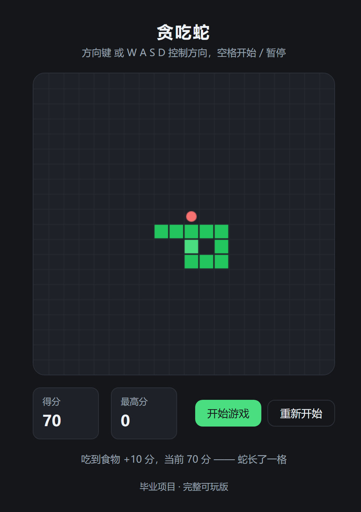

# 贪吃蛇 · Snake

一个运行在浏览器里的贪吃蛇小游戏，作为毕业项目。**纯 HTML + CSS + JavaScript，无需安装任何东西。**

现在已经**可以完整玩一局**：蛇会跑、能转向、会吃食物，撞到墙或自己的身体就结束，并显示最终分数。



## 游戏介绍

你要控制一条不断变长的蛇，在 400 × 400 的棋盘里吃红色的圆形食物：

- 每吃到一个食物，蛇身**长一格**、分数 **+10**，并在随机位置出现新食物
- 蛇**不能直接反向掉头**（向右走时不能一步改成向左），只能转 90 度
- **撞到墙或咬到自己**，游戏立即结束，显示「游戏结束」和最终分数
- 棋盘为 20 × 20 格，每格 20 像素，蛇每秒移动 8 格（均可在 `game.js` 的 `CONFIG` 中调整）

蛇画成方块（蛇头浅绿、身体深绿）、食物画成红色圆点，形状不同是为了扫一眼就能分清。

## 如何启动

不需要安装任何东西，也不需要构建工具：

1. 下载或克隆本仓库
2. 双击 `index.html`，用浏览器打开即可

打开后应该看到：一个 400 × 400 的深色棋盘（带网格线）、上方「贪吃蛇」标题，下方「得分 / 最高分」面板和「开始游戏」「重新开始」两个按钮。棋盘中央有一条**由三个方块组成的蛇**（头尾深浅不同的绿色），此时它静止不动。

点击「开始游戏」，蛇就会**按固定速度向右移动**（每秒 8 格，即每 125 毫秒走一格），用方向键或 `W` `A` `S` `D` 可以让它转弯去吃食物。撞到墙或自己的身体时游戏结束，棋盘上会盖一层提示，写着「游戏结束」和这一局的最终分数。

> 注意：「最高分」面板目前**恒为 0** —— 最高分记录还没实现，见下方待实现清单。

## 操作方法

| 操作 | 方式 |
|---|---|
| 开始 | 点击「开始游戏」按钮，或按空格 |
| 暂停 / 继续 | 空格 |
| 重新开始 | 点击「重新开始」按钮 |
| 改变方向 | 方向键 ↑ ↓ ← → 或 `W` `A` `S` `D` |

**转向规则**：只能转 90 度，**不能直接反向掉头**。比如蛇正在向右移动时，按 ← 或 `A` 没有任何效果（棋盘下方会给出提示），必须先转成上或下，才能再转到左。

**为什么快速连按也不会出错**：按键不会立刻改变蛇的方向，而是先"排队"，等蛇走到下一格时才生效。判断能不能转，用的是蛇**真正在走的方向**（而不是你上一次按的方向）。这样即使你在 125 毫秒内连按好几个键，也不会出现"两次合法按键拼出一个掉头"导致蛇撞死自己的情况。

## 用了哪些文件

```
git-snakegame/
├── index.html      页面结构：标题、画布、分数面板、按钮
├── style.css       样式：配色变量、布局、棋盘外观、按钮状态
├── game.js         游戏逻辑：配置、状态、移动、转向、食物、碰撞、绘制、事件
├── screenshot.png  游戏截图（就是本页最上面那张）
├── README.md       项目说明（本文件）
└── .gitignore      忽略 Python 缓存与虚拟环境目录
```

三个核心文件的职责划分：

| 文件 | 负责什么 | 不负责什么 |
|---|---|---|
| `index.html` | 页面有哪些元素 | 长什么样、怎么动 |
| `style.css` | 元素长什么样 | 元素的增删和游戏逻辑 |
| `game.js` | 游戏怎么动 | 页面结构和样式 |

## 游戏规则

### 食物

| 规则 | 说明 |
|---|---|
| 出现位置 | 随机，但**一定在网格内的空格子上**，绝不会压在蛇身上 |
| 吃到以后 | 蛇身**增加一格**（多长一节），分数 **+10**，并立刻在别处生成新的食物 |
| 没吃到 | 食物原地不动，蛇的长度和分数都不变 |

### 游戏结束

| 结束条件 | 说明 |
|---|---|
| 撞到墙 | 蛇头走出棋盘边界 |
| 咬到自己 | 蛇头落到自己身体的某一节上 |

结束时会**立刻停止移动**（蛇保持在撞上的前一格位置），棋盘上盖一层提示层，写着「游戏结束」和**这一局的最终分数**；棋盘下方的状态栏也会说明是撞墙还是咬到自己。

按空格、点提示层、或点「重新开始」都能开新一局。

**一个容易做错的细节**：判断"咬到自己"时，如果这一步**没吃到食物**，尾巴会同时向前让开一格 —— 所以「蛇头压到尾巴原来的位置」**不算撞**。不处理这一点的话，蛇贴着尾巴转弯会被误判成死亡。代码里通过"排除尾巴那一节"来实现。

## 已完成功能

- [x] 400 × 400 像素的游戏区域（Canvas）
- [x] 页面标题「贪吃蛇」
- [x] 当前分数显示（含最高分占位）
- [x] 「开始游戏」与「重新开始」按钮
- [x] 深色棋盘与网格线绘制
- [x] 蛇的初始化（3 个方块，位于棋盘中央，方向向右）
- [x] 蛇的移动：头进尾出、长度不变，固定速度 8 格/秒
- [x] 主循环与移动节奏控制（时间累加器，掉帧也不会加速）
- [x] 开始 / 暂停 / 重新开始的状态切换
- [x] 方向键与 `W` `A` `S` `D` 控制方向（大小写都可以）
- [x] 禁止反向掉头，且快速连续按键不会出错
- [x] 随机食物：只出现在空格子上，绝不生成在蛇身上
- [x] 吃到食物：身体增加一格、分数 +10、立刻生成新食物
- [x] 碰撞检测：撞墙 / 咬到自己 → 停止移动
- [x] 游戏结束画面：「游戏结束」+ 最终分数，并说明结束原因

## 待实现清单

- [ ] 最高分记录（「最高分」面板目前恒为 0，可存入 localStorage）
- [ ] 移动端触屏操作（可选）
- [ ] 音效与动画（可选）

## 技术说明

- 绘制方式：原生 Canvas 2D
- 无第三方依赖，纯 HTML + CSS + JavaScript
- 棋盘为 20 × 20 格，每格 20 像素（可在 `game.js` 的 `CONFIG` 中调整）
- 吃一个食物加 10 分（`CONFIG.scorePerFood`）
- 食物的生成方式：先把"被蛇占住的格子"列成集合，再把空着的格子全收集起来，最后从空格里随机挑一个。这样蛇再长也不会出现"随机试半天试不中"甚至卡死的情况
- 游戏结束不靠"额外的停止指令"：把状态改成 `over` 后，主循环下一次被调用时就会自己退出，蛇自然停住
- 碰撞判断在移动**之前**进行；撞上就不移动，所以画面会定格在"撞上前一格"的位置

## 版本记录

- 结构搭建：完成页面骨架、样式与代码骨架
- 基础界面（Issue #1）：400 × 400 游戏区域、标题、当前分数、开始按钮；蛇暂不移动
- 蛇的出现与移动：三格长的蛇，点击开始后按固定速度向右移动；暂无食物与碰撞
- 控制方向（Issue #2）：方向键与 WASD 转向，排队生效、禁止掉头、可快速连按
- 食物与进食：随机食物不压蛇身；吃到身体加长一格、分数 +10 并生成新食物
- 游戏结束规则：撞墙或咬到自己即停止移动，显示「游戏结束」与最终分数；至此游戏可完整游玩
- 完善 README（Issue #3）：补充游戏截图，按 Issue 清单整理出游戏介绍、操作方法、如何启动、用了哪些文件、已完成功能六个板块
